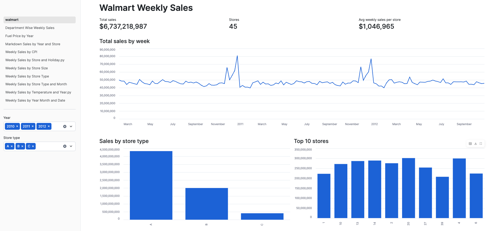
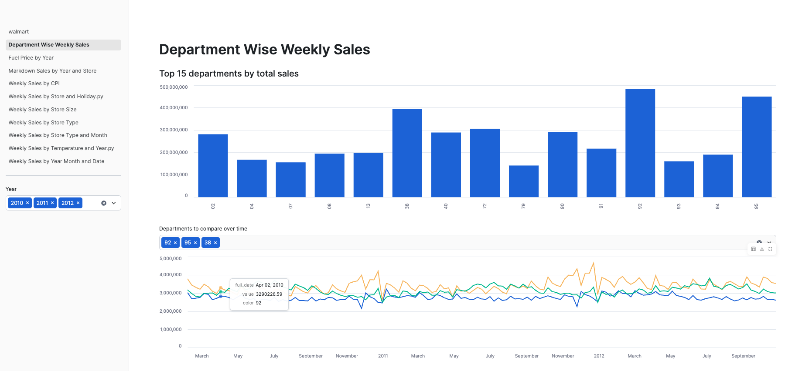
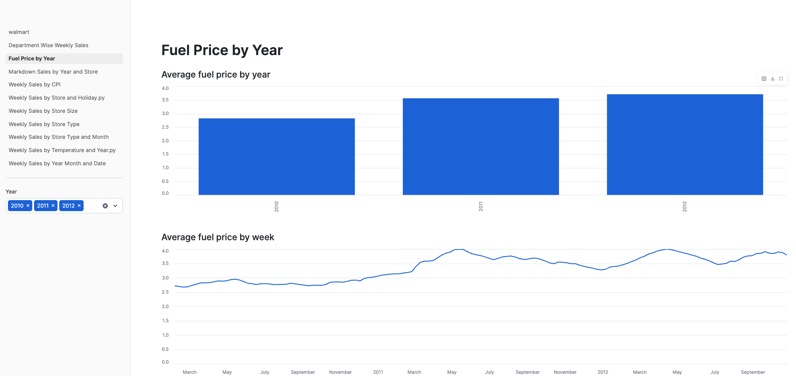
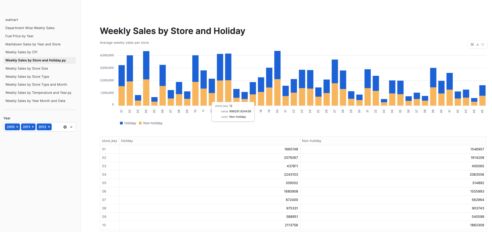
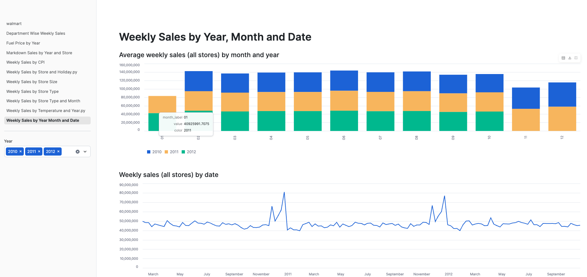

# Walmart Sales Analytics: S3, Snowflake, dbt, Streamlit

An end-to-end analytics pipeline. Raw CSV files in S3 are loaded into Snowflake, modeled into a star schema with dbt, and visualized in a multi-page Streamlit in Snowflake app.

## Architecture

CSV files (S3) -> Snowflake RAW schema -> dbt staging models -> dbt marts (2 dimensions + 1 fact) -> Streamlit app

## What I built

- An S3 bucket and a Snowflake storage integration, with a read-only IAM policy scoped to one folder
- Loaded three CSV files with `COPY INTO`, with column types inferred from the file headers
- A dbt project with 3 staging models, 2 dimension tables (`dim_store`, `dim_date`) and 1 fact table (`fct_weekly_sales`, about 421K rows)
- dbt tests: unique, not_null, relationships between the fact and each dimension, and a custom test for the fact table's grain
- A 10-page Streamlit app covering sales by store, holiday, temperature, store size, store type, month, markdowns, fuel price, CPI, and department

## Data model

| Table | Grain | Rows |
|---|---|---|
| `dim_store` | one row per store | 45 |
| `dim_date` | one row per week | 182 |
| `fct_weekly_sales` | one row per store, department, and week | 421,570 |

## Data quality decisions

- Weekly conditions (temperature, CPI, fuel price, markdowns) are recorded per store and week, so they repeat on every department row once joined to the fact. The app rolls data up to store-week before summing or averaging, to avoid double-counting.
- Source values of "NA" in the markdown columns are converted to nulls.
- A custom dbt test checks that no store, department, and week combination appears twice.

## Repository layout

- `models/`: dbt staging and mart models
- `tests/`: custom dbt test
- `snowflake/setup.sql`: S3 stage and load commands (private values replaced with placeholders)
- `streamlit_app/`: the Streamlit in Snowflake app
- `profiles.yml.example`: sample dbt connection profile

## Screenshots

## How to run it

1. Create an S3 bucket, upload the CSV files, and run `snowflake/setup.sql`
2. Copy `profiles.yml.example` to `~/.dbt/profiles.yml` and fill in your values
3. Run `pip install dbt-snowflake`, then `dbt build`
4. Create a Streamlit in Snowflake app and paste in the files from `streamlit_app/`

## Data source

(add a link to where the dataset came from. The data files are not included in this repo.)

## Tools

Snowflake, dbt, AWS S3 and IAM, Streamlit, SQL, Python
